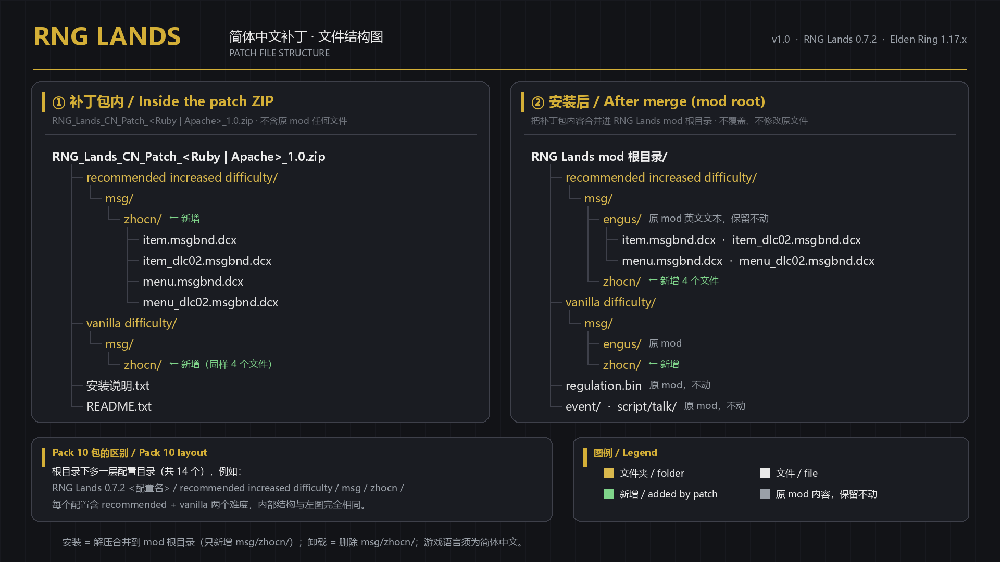

# RNG Lands 简体中文补丁 / Simplified Chinese Patch


> **RNG Lands 0.7.2 · Elden Ring 1.17.x · v1.0.0**
> 物品名 / 说明 / 随机故事 / 菜单 / 教程 / HUD —— 全量中文

---

## 这是什么

本仓库发布 **RNG Lands**（Elden Ring 的随机化 mod，Nexus mod 3229）的**简体中文文本补丁**。

补丁**只包含翻译文本**（`msg/zhocn` 下的 DCX 文件），**不包含原 mod 的任何文件**。
使用前请自行安装原版 RNG Lands；补丁按"合并进 mod 目录"的方式生效。

## 覆盖率

- **16 个内容组、约 155 万条文本槽位**全部有中文；
- 其中约 **33.9 万条为官方简中继承**（与原版游戏文本逐字一致处），其余为项目译文；
- `item_dlc02` 每个变体写入 **95,720 条**译文；`item` / `menu` / `menu_dlc02` 走官方继承 + 跨档案补译 + 人工补译；
- 覆盖范围：
  - 物品名与说明（武器 / 防具 / 道具 / 护符 / 战灰 / 骨灰…）
  - **随机故事**（武器、防具、道具的随机生成说明）
  - 菜单、系统提示、教程弹窗
  - HUD 警告（武器损坏 / 防具耐久告急）

## 适用版本

| 项 | 要求 |
|---|---|
| RNG Lands | **0.7.2**（Nexus mod 3229 的 Ruby / Apache / Pack 10 三个发行包） |
| Elden Ring | **1.17.x**（1.17.1 实测通过） |
| 游戏语言 | **简体中文**（必须；否则游戏读取 `engus`，补丁不生效） |
| 加载方式 | 用你平时加载 RNG Lands 的方式即可（ModEngine / me3 / 手动替换均可） |

## 下载

`downloads/` 里每个 zip 对应一个 RNG Lands 变体，**recommended / vanilla 两个难度通用**：

| RNG Lands 发行包 | 补丁文件 |
|---|---|
| **Ruby** | `RNG-Lands-CN-ruby-base-recommended_increased-v1-20261017.zip` |
| **Apache** | `RNG-Lands-CN-apache-base-recommended_increased-v1-20261017.zip` |
| **Pack 10**（14 个配置） | `RNG-Lands-CN-pack_10-<配置名>-recommended_increased-v1-20261017.zip` ×14 |

> 不确定用哪个：看你的 RNG Lands 目录名（Ruby / Apache / Pack 10），Pack 10 再看配置文件夹名。
> 详细的对照表见 [docs/VARIANT-MAP.md](docs/VARIANT-MAP.md)。
>
> 也可以到 **Releases** 页下载合并包（全部 16 组）与 Nexus 风格的三个打包（Ruby / Apache / Pack 10）。

## 安装

1. 先安装原版 **RNG Lands 0.7.2**（对应你的 Ruby / Apache / Pack 10 发行包）。
2. 把对应 zip 解压，**合并**到 RNG Lands 的 mod 根目录
   （即包含 `recommended increased difficulty` / `vanilla difficulty` 的那一层；
   Pack 10 则是包含 14 个配置目录的那一层）。
   补丁只新增 `msg/zhocn/`，不会改动 mod 原文件。
3. 把游戏语言设为**简体中文**，启动游戏。



### 卸载

删除对应难度目录 / 配置目录下的 `msg/zhocn/` 文件夹即可。

## 校验

`SHA256SUMS.txt` 列出 `downloads/` 中所有 zip 的 SHA-256；解压前可先校验。

## 已知问题

- 少量条目保持英文：它们是 mod 自身的 `[ERROR]` 占位条目（英文版同样显示 `[ERROR]`），不属于漏翻；
- 服务条款（ToS）法律文本保持英文——官方简体中文文件里 ToS 本身也是英文；
- `script/talk` 与 `event` 文本不在这套 msg BND 内，本补丁未处理。

如果看到**本应翻译**的物品名 / 菜单仍是英文，欢迎开 Issue 或 PR，注明"物品名 / 菜单位置"。

## 授权与致谢

- **翻译文本**：© 2026 本仓库作者，按 [CC BY-NC-SA 4.0](https://creativecommons.org/licenses/by-nc-sa/4.0/) 发布——
  允许转载 / 整合，需注明本仓库并保留链接；**禁止商用**。
- **原游戏文本** © FromSoftware, Inc. / Bandai Namco Entertainment；**RNG Lands** © 其作者。
  本仓库只分发翻译文本，不包含原 mod / 原游戏文件；使用需自行拥有游戏并安装原 mod。
- 本仓库与 FromSoftware、Bandai Namco、RNG Lands 作者均无隶属关系。

## 仓库结构

```text
RNG-Lands-CN/
├─ README.md
├─ CHANGELOG.md
├─ LICENSE
├─ SHA256SUMS.txt
├─ downloads/                    # 16 个变体的中文补丁 zip
├─ images/                       # 头图 / 文件结构图
└─ docs/
   ├─ VARIANT-MAP.md             # 变体 ↔ 补丁文件对照表
   ├─ NEXUS-FILES.md             # N 网发布文件说明（备用）
   └─ NEXUS-DESCRIPTION.bbcode   # N 网发布页说明（备用）
```

---

## English

**Simplified Chinese translation patch for RNG Lands 0.7.2 on Elden Ring 1.17.x.**

- Translation text only (`msg/zhocn` DCX files); **no files from the original mod are included**.
- Covers item names & descriptions, randomizer story captions, menus, tutorials and HUD messages.
- Pick the zip matching your RNG Lands package (Ruby / Apache / Pack 10) from `downloads/`,
  merge it into the RNG Lands mod root, and set the game language to Simplified Chinese.
- Uninstall: delete the added `msg/zhocn/` folder(s).
- Known: the mod's own `[ERROR]` placeholder entries stay as-is; ToS text remains English
  (the official Simplified Chinese files keep ToS in English too); `script/talk` and `event` text are out of scope.
- Translation text is licensed under CC BY-NC-SA 4.0. Original game text © FromSoftware / Bandai Namco;
  RNG Lands © its author. This repository only distributes translation text.
